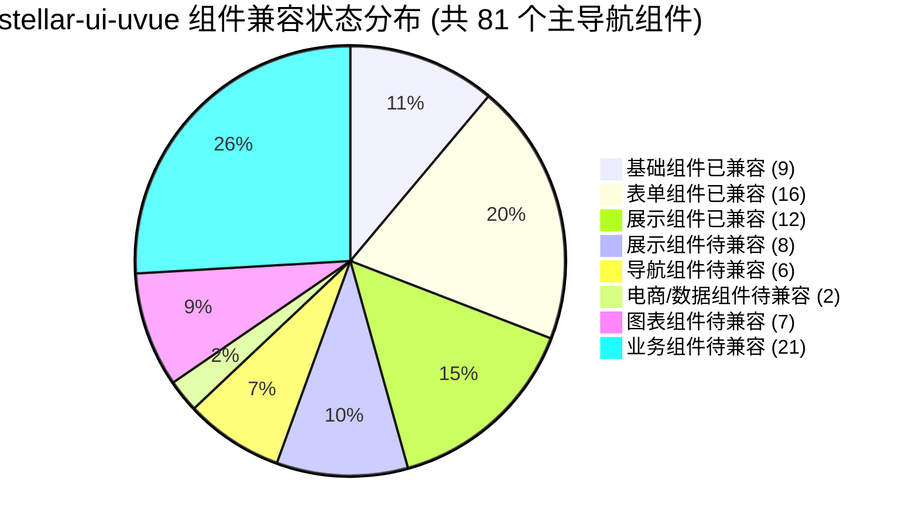
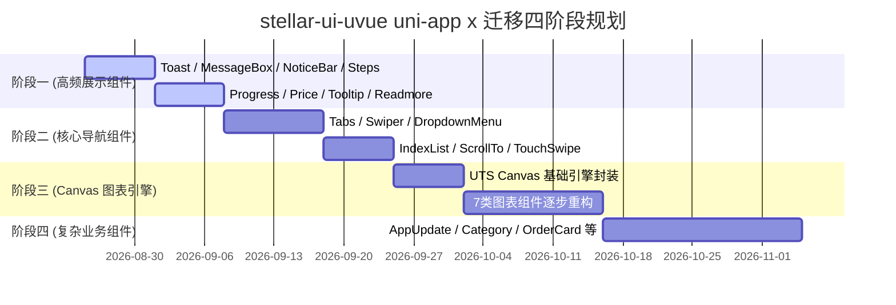

# Stellar UI uvue uni-app x 兼容进度与全景架构分析报告

> **文档版本**：v1.0.0  
> **更新时间**：2026-08-24  
> **项目定位**：`stellar-ui-uvue` 组件库从 Vue3 到 uni-app x (UTS/UVUE) 的迁移与兼容改造（历史阶段报告）  
> **状态说明**：本报告为迁移阶段的历史快照，文中的进度数据、组件状态与路线图不代表当前状态。组件库当前**仅针对 App 端（Android / iOS）完成适配与验证**，H5 / Web 与各小程序端均未做兼容性验证，不提供可用性承诺。

---

## 一、 项目背景与架构概述

### 1.1 背景说明
`stellar-ui-uvue` 原为基于 Vue3 开发的 Uni-app 多端组件库。随着 DCloud 推出下一代纯原生开发框架 **uni-app x**，为提升原生渲染性能，组件库正在进行向 uni-app x (UTS + UVUE) 体系的重构与兼容升级。

### 1.2 uni-app x 技术体系核心约束
组件库的适配与验证以 App 端（Android / iOS）编译运行为主要目标，迁移过程中需遵守 uni-app x 的核心规范：
1. **语言层面**：逻辑层全面使用 **UTS (uni-app TypeScript)**，强静态类型，对象字面量赋值需使用明确的 `type` 声明，禁止使用未定义的动态属性；
2. **模板与样式**：
   - 视图层采用 **UVUE**；
   - CSS 布局引擎默认为 Flexbox（默认 `flex-direction: column`），不支持通配符选择器 `*`、复杂的层级嵌套选择器以及部分不支持的伪类；
   - 尺寸单位优先使用 `rpx` 与 `px`；
3. **平台差异与 API**：
   - 统一使用 `uni.getWindowInfo()` 替代废弃的 `uni.getSystemInfoSync()`；
   - Canvas 统一采用 **Canvas 2D** 接口与 `id` 绑定。

---

## 二、 兼容进度总览看板

### 2.1 核心统计指标



| 统计项 | 当前已完成 | 计划总数 | 完成率 | 说明 |
| :--- | :---: | :---: | :---: | :--- |
| **主导航组件 (Demo 目录项)** | **37** | **81** | **45.68%** | 覆盖 Demo 首页 8 大分类中的主入口 |
| **组件物理目录 (含附带/子组件)** | **41** | **92** | **44.57%** | 包含 Group/Item 类子组件目录 |
| **交互式 Demo 页面 (真实用例)** | **37** | **81** | **45.68%** | 37 个包含多状态用例，44 个为骨架占位 |
| **底层通用工具库 (Utils/Store/Config)** | **5** | **7** | **~71.4%** | `utils.uts`、`Color.uts`、`store/color.uts` 等已适配 |

---

### 2.2 八大分类完成率速览

| 分类名称 | 分类标识 | 已完成数 / 总数 | 分类进度 | 状态概括 |
| :--- | :--- | :---: | :---: | :--- |
| **1. 基础组件** | `basic` | **9 / 9** | `100.0%` | ✅ **全部完成**，基础视觉与布局就绪 |
| **2. 表单组件** | `form` | **16 / 16** | `100.0%` | ✅ **全部完成**，输入、选择、开关等全面可用 |
| **3. 展示组件** | `preview` | **12 / 20** | `60.0%` |  **稳步过半**，已完成动画、条码、加载、跑马灯、步骤条、滑动单元格、表格、轻提示、指引、树形、视频等 |
| **4. 导航组件** | `navigation`| **0 / 6** | `0.0%` | ❌ **待改造** (Tabs, Swiper, DropdownMenu 等) |
| **5. 电商组件** | `ecommerce` | **0 / 1** | `0.0%` | ❌ **待改造** (Price 价格) |
| **6. 数据组件** | `data` | **0 / 1** | `0.0%` | ❌ **待改造** (Progress 进度条) |
| **7. 图表组件** | `chart` | **7 / 7** | `100.0%` | ✅ **全部完成**，纯 UTS 统一图表引擎（StellarChartEngine）就绪 |
| **8. 业务组件** | `business` | **0 / 21** | `0.0%` | ❌ **待改造** (复杂复合业务模板) |

---

## 三、 八大分类组件兼容明细清单

### 3.1 基础组件【Basic】(9/9 - 100%)
| 组件名称 | 标签名 | 物理目录 | 状态 | Demo 状态 | 核心功能点 |
| :--- | :--- | :--- | :---: | :---: | :--- |
| **Badge 徽标** | `<ste-badge>` | `ste-badge` | ✅ 已兼容 | ✅ 完整 | 数字角标、红点、自定义背景、最大值限制 |
| **Button 按钮** | `<ste-button>` | `ste-button` | ✅ 已兼容 | ✅ 完整 | 多尺寸、渐变色、加载中状态、边框与直角模式 |
| **Drag 拖拽** | `<ste-drag>` | `ste-drag` | ✅ 已兼容 | ✅ 完整 | 自由拖拽定位、吸边贴靠逻辑 |
| **Drag Sort 拖拽排序** | `<ste-drag-sort>` | `ste-drag-sort` | ✅ 已兼容 | ✅ 完整 | 列表项长按拖拽排序交互 |
| **Icon 图标** | `<ste-icon>` | `ste-icon` | ✅ 已兼容 | ✅ 完整 | 字体图标渲染、自定义颜色与字号 |
| **Popup 弹出层** | `<ste-popup>` | `ste-popup` | ✅ 已兼容 | ✅ 完整 | 上/下/左/右/居中弹出、遮罩层动画控制 |
| **Skeleton 骨架屏** | `<ste-skeleton>` | `ste-skeleton` | ✅ 已兼容 | ✅ 完整 | 头像/段落骨架占位、闪烁动效 |
| **Sticky 吸顶** | `<ste-sticky>` | `ste-sticky` | ✅ 已兼容 | ✅ 完整 | 页面滚动吸顶布局 |
| **Text 文本** | `<ste-text>` | `ste-text` | ✅ 已兼容 | ✅ 完整 | 文本截断、颜色与行高预设 |

---

### 3.2 表单组件【Form】(16/16 - 100%)
| 组件名称 | 标签名 | 物理目录 | 状态 | Demo 状态 | 核心功能点 |
| :--- | :--- | :--- | :---: | :---: | :--- |
| **Calendar 日历** | `<ste-calendar>` | `ste-calendar` | ✅ 已兼容 | ✅ 完整 | 单选、多选、范围选择、农历/节假日拓展 |
| **Checkbox 复选框** | `<ste-checkbox>` | `ste-checkbox`, `ste-checkbox-group` | ✅ 已兼容 | ✅ 完整 | 多选框组、限制最大可选数、自定义图标 |
| **CodeInput 验证码输入** | `<ste-code-input>` | `ste-code-input` | ✅ 已兼容 | ✅ 完整 | 4/6位短信验证码方块/下划线输入模式 |
| **DatePicker 时间选择器** | `<ste-date-picker>` | `ste-date-picker` | ✅ 已兼容 | ✅ 完整 | 年月日时分秒列选择交互 |
| **Image 图片** | `<ste-image>` | `ste-image` | ✅ 已兼容 | ✅ 完整 | 懒加载、加载占位图、加载失败兜底 |
| **Input 输入框** | `<ste-input>` | `ste-input` | ✅ 已兼容 | ✅ 完整 | 文本录入、清除按钮、前后缀插槽、字数统计 |
| **Radio 单选框** | `<ste-radio>` | `ste-radio`, `ste-radio-group` | ✅ 已兼容 | ✅ 完整 | 单选按钮组、禁用状态、主题色定制 |
| **Rate 评分** | `<ste-rate>` | `ste-rate` | ✅ 已兼容 | ✅ 完整 | 星级打分、半星支持、自定义图标 |
| **RichText 富文本** | `<ste-rich-text>` | `ste-rich-text` | ✅ 已兼容 | ✅ 完整 | HTML 字符串富文本渲染解析 |
| **Search 搜索** | `<ste-search>` | `ste-search` | ✅ 已兼容 | ✅ 完整 | 搜索输入框、快捷操作按钮、防抖搜索 |
| **Select 下拉选/选择器** | `<ste-select>` | `ste-select`, `ste-picker` | ✅ 已兼容 | ✅ 完整 | 单列/多列联动选择器、浮层式下拉选 |
| **Signature 签名** | `<ste-signature>` | `ste-signature` | ✅ 已兼容 | ✅ 完整 | 基于 Canvas 的手写电子签名板与导出 |
| **Slider 滑块** | `<ste-slider>` | `ste-slider` | ✅ 已兼容 | ✅ 完整 | 连续/离散滑块数值调节、步长控制 |
| **Stepper 步进器** | `<ste-stepper>` | `ste-stepper` | ✅ 已兼容 | ✅ 完整 | 数量加减、最小/最大边界、长按加速 |
| **Switch 开关** | `<ste-switch>` | `ste-switch` | ✅ 已兼容 | ✅ 完整 | 开关状态切换、自定义文案与颜色 |
| **Upload 上传** | `<ste-upload>` | `ste-upload` | ✅ 已兼容 | ✅ 完整 | 本地多图选择、上传进度预览、删除交互 |

---

### 3.3 展示组件【Preview】(5/18 - 27.8%)
| 组件名称 | 标签名 | 物理目录 | 状态 | Demo 状态 | 核心功能点 / 待改造说明 |
| :--- | :--- | :--- | :---: | :---: | :--- |
| **Animate 动画** | `<ste-animate>` | `ste-animate` | ✅ 已兼容 | ✅ 完整 | 淡入淡出、缩放、弹跳等多预设动效封装 |
| **Barcode 条形码** | `<ste-barcode>` | `ste-barcode` | ✅ 已兼容 | ✅ 完整 | Code128 纯 UTS 编码与 Canvas 2D 绘制 |
| **Loading 加载动画** | `<ste-loading>` | `ste-loading` | ✅ 已兼容 | ✅ 完整 | 多种 Loading 形状与主题色动效 |
| **Marquee 走马灯** | `<ste-marquee>` | `ste-marquee` | ✅ 已兼容 | ✅ 完整 | 文本跑马灯、垂直/水平无缝轮播 |
| **MediaPreview 媒体预览** | `<ste-media-preview>` | `ste-media-preview` | ✅ 已兼容 | ✅ 完整 | 图片与视频全屏轮播预览与手势缩放 |
| **MessageBox 弹框** | `<ste-message-box>` | `ste-message-box` | ❌ 待兼容 | ⏳ 待开发 | 确认框、提示框与输入弹框 |
| **NoticeBar 公告栏** | `<ste-notice-bar>` | `ste-notice-bar` | ❌ 待兼容 | ⏳ 待开发 | 顶部滚动公告通告栏 |
| **NumberKeyboard 数字键盘** | `<ste-number-keyboard>` | `ste-number-keyboard` | ❌ 待兼容 | ⏳ 待开发 | 支付/身份证专用虚拟数字键盘 |
| **QRcode 二维码** | `<ste-qrcode>` | `ste-qrcode` | ❌ 待兼容 | ⏳ 待开发 | 二维码生成引擎 UTS 改造 |
| **Readmore 阅读更多** | `<ste-read-more>` | `ste-read-more` | ❌ 待兼容 | ⏳ 待开发 | 长文本折叠展开与渐变遮罩 |
| **Steps 步骤条** | `<ste-steps>` | `ste-steps`, `ste-step` | ✅ 已兼容 | ✅ 完整 | 流程进度节点展示 |
| **SwipeAction 滑动单元格** | `<ste-swipe-action>` | `ste-swipe-action`, `ste-swipe-action-group` | ✅ 已兼容 | ✅ 完整 | 左右滑动显示操作按钮（手势交互） |
| **Table 表格** | `<ste-table>` | `ste-table`, `ste-table-column` | ✅ 已兼容 | ✅ 完整 | 数据表格排版、固定表头吸顶、固定滚动、多选/单选、合计行与多态单元格 |
| **Toast 轻提示** | `<ste-toast>` | `ste-toast` | ✅ 已兼容 | ✅ 完整 | 全局快捷浮层消息提示、Ref/组合式函数调用、多态图标与排队队列 |
| **Tooltip 气泡提示** | `<ste-tooltip>` | `ste-tooltip` | ❌ 待兼容 | ⏳ 待开发 | 元素锚点气泡说明 |
| **Tour 指引** | `<ste-tour>` | `ste-tour` | ✅ 已兼容 | ✅ 完整 | 新手指引高亮遮罩步进、多步骤联动、小三角指向与插槽自定义 |
| **Tree 树形控件** | `<ste-tree>` | `ste-tree` | ✅ 已兼容 | ✅ 完整 | 层级树形数据折叠展开、手风琴模式、异步懒加载、默认展开与实时搜索 |
| **Video 视频** | `<ste-video>` | `ste-video` | ✅ 已兼容 | ✅ 完整 | 原生视频播放器增强封装、自定义控制栏、清晰度无缝切换与多倍速播放 |
| **Watermark 水印** | `<ste-watermark>` | `ste-watermark` | ❌ 待兼容 | ⏳ 待开发 | 全局/局部防篡改背景水印 |

---

### 3.4 导航组件【Navigation】(0/6 - 0%)
| 组件名称 | 标签名 | 物理目录 | 状态 | 改造重点 |
| :--- | :--- | :--- | :---: | :--- |
| **DropdownMenu 下拉菜单** | `<ste-dropdown-menu>` | `ste-dropdown-menu`, `ste-dropdown-menu-item` | ❌ 待兼容 | 锚点绝对定位与遮罩事件冒泡处理 |
| **IndexList 索引列表** | `<ste-index-list>` | `ste-index-list`, `ste-index-item` | ❌ 待兼容 | 字母侧边栏触控与右侧列表快速滚动定位 |
| **ScrollTo 滚动锚点** | `<ste-scroll-to>` | `ste-scroll-to`, `ste-scroll-to-item` | ❌ 待兼容 | 页面/容器内滚动监听与联动锚点高亮 |
| **Swiper 轮播组件** | `<ste-swiper>` | `ste-swiper`, `ste-swiper-item` | ❌ 待兼容 | uni-app x 差异化 swiper 原生触控优化 |
| **Tabs 标签页** | `<ste-tabs>` | `ste-tabs`, `ste-tab` | ❌ 待兼容 | 标签栏滑动跟随、下划线动画计算 |
| **TouchSwipe 手势切屏** | `<ste-touch-swipe>` | `ste-touch-swipe`, `ste-touch-swipe-item` | ❌ 待兼容 | 页面整屏手势横纵向翻页 |

---

### 3.5 电商组件与数据组件 (0/2 - 0%)
| 组件名称 | 标签名 | 物理目录 | 状态 | 改造重点 |
| :--- | :--- | :--- | :---: | :--- |
| **Price 价格** | `<ste-price>` | `ste-price` | ❌ 待兼容 | 金额符号、千分位、小数排版对齐 |
| **Progress 进度条** | `<ste-progress>` | `ste-progress` | ❌ 待兼容 | 条形/环形进度动效与百分比插槽 |

---

### 3.6 图表组件【Chart】(7/7 - 100%)
| 组件名称 | 标签名 | 物理目录 | 状态 | Demo 状态 | 核心功能点与适配说明 |
| :--- | :--- | :--- | :---: | :---: | :--- |
| **AreaChart 面积图** | `<ste-area-chart>` | `ste-area-chart` | ✅ 已兼容 | ✅ 完整 | 基于纯 UTS 统一图表引擎（StellarChartEngine），支持下沉闭合区间半透明渐变填充与入场生长动效 |
| **BarChart 条状图** | `<ste-bar-chart>` | `ste-bar-chart` | ✅ 已兼容 | ✅ 完整 | 横向柱状伸展算法，Y 轴分类长文案适配、微圆角质感与向右平滑生长 |
| **ColumnChart 柱状图** | `<ste-column-chart>` | `ste-column-chart` | ✅ 已兼容 | ✅ 完整 | 纵向多序列并列对比、柱顶微圆角自适应计算与向上拔高动画 |
| **FunnelChart 漏斗图** | `<ste-funnel-chart>` | `ste-funnel-chart` | ✅ 已兼容 | ✅ 完整 | 梯形截面梯度收窄渲染、流失转化率居中标注与平滑展开 |
| **LineChart 折线图** | `<ste-line-chart>` | `ste-line-chart` | ✅ 已兼容 | ✅ 完整 | 直线折线与三次贝塞尔平滑曲线 (curve) 双模式、手势十字吸附准星与 Tooltip 浮层 |
| **PieChart 饼图** | `<ste-pie-chart>` | `ste-pie-chart` | ✅ 已兼容 | ✅ 完整 | 极坐标系扇形弧度计算、顺时针弧度展开动画、百分比文案与手势拾取 |
| **RingChart 环形图** | `<ste-ring-chart>` | `ste-ring-chart` | ✅ 已兼容 | ✅ 完整 | 中空中空挖孔圆环、中心核心指标标题/副标题排版与扇区展开动画 |

---

### 3.7 业务组件【Business】(0/21 - 0%)
| 组件名称 | 物理目录 | 状态 | 功能简述 |
| :--- | :--- | :---: | :--- |
| **AppUpdate APP更新** | `ste-app-update` | ❌ 待兼容 | 原生应用热更与整包升级弹窗及下载进度 |
| **Category 分类** | `ste-category` | ❌ 待兼容 | 左侧一级分类联动右侧二级/三级列表 |
| **Comment 评价** | `ste-comment` | ❌ 待兼容 | 商品/动态多图评论列表与点赞回复 |
| **CouponList 券列表** | `ste-coupon-list` | ❌ 待兼容 | 优惠券展示、领取状态与样式排版 |
| **CustomKeyboard 定制键盘** | `ste-custom-keyboard` | ❌ 待兼容 | 业务定制输入键盘 |
| **DateUser 人员信息与日期** | `ste-date-user` | ❌ 待兼容 | 日期与人员协同选择业务组合卡片 |
| **FilterTool 筛选选项** | `ste-filter-tool` | ❌ 待兼容 | 多维度标签筛选与重置确认面板 |
| **FunctionList 功能列表** | `ste-function-list` | ❌ 待兼容 | 宫格/列表式应用功能中心入口 |
| **GoodsInfo 商品信息** | `ste-goods-info` | ❌ 待兼容 | 商品详情基础信息展示卡片 |
| **GoodsList 商品列表** | `ste-goods-list` | ❌ 待兼容 | 双列/单列商品流排版组件 |
| **GuideQA 引导服务区** | `ste-guide-qa` | ❌ 待兼容 | 常见问答折叠交互区 |
| **Login 登录** | `ste-login` | ❌ 待兼容 | 快捷登录、手机号验证码登录标准模板 |
| **LoginInfo 登录信息** | `ste-login-info` | ❌ 待兼容 | 用户当前登录状态卡片 |
| **Navbar 导航栏** | `ste-navbar` | ❌ 待兼容 | 沉浸式自定义顶部导航与胶囊按钮适配 |
| **OrderCard 订单卡片** | `ste-order-card` | ❌ 待兼容 | 订单状态、商品清单与操作按钮卡片 |
| **SearchBox 搜索组件** | `ste-search-box` | ❌ 待兼容 | 历史搜索、热门推荐复合搜索面板 |
| **SelectOrder 订单选择** | `ste-select-order` | ❌ 待兼容 | 业务订单关联选择列表 |
| **SelectSeat 座位选择** | `ste-select-seat` | ❌ 待兼容 | 影院/活动会场选座交互视图 |
| **SimpleCalendar 简单日历** | `ste-simple-calendar`| ❌ 待兼容 | 轻量打卡/签到日历卡片 |
| **Slide Verify 滑动验证** | `ste-slide-verify` | ❌ 待兼容 | 滑块拼图防刷安全验证 |
| **UserInfo 用户信息** | `ste-user-info` | ❌ 待兼容 | 个人中心头部头像与信息卡片 |

---

## 四、 底层基础设施与通用模块适配状态

组件库底层通用库已建立完善的 UTS 适配体系：

```
uni_modules/stellar-ui-uvue/
├── utils/
│   ├── utils.uts           # [UTS] 系统尺寸、DOM 节点查询、单位格式化、防抖节流
│   ├── Color.uts           # [UTS] HEX/RGB/RGBA 颜色计算、明暗度、渐变色生成
│   ├── System.uts          # [UTS] 跨端平台系统环境判定
│   └── index.uts           # [UTS] 公共工具函数统一入口
├── config/
│   ├── color.uts           # [UTS] 基础调色板与主题预设
│   ├── font-size.uts       # [UTS] 标准字号规范
│   └── index.uts           # [UTS] 配置中心导出
├── store/
│   └── color.uts           # [UTS] 基于 reactive 的全局主题色状态中心
└── types/
    └── index.uts           # [UTS] 全局核心通用数据类型
```

---

## 五、 现存关键技术发现与规范建议

在对工程源码深度扫描后，发现以下后续重构阶段需要规范和处理的技术要点：

1. **双版本文件并存问题**：
   - 33 个已转换的组件目录中同时存在 `.vue` 和 `.uvue` 两个模板文件（例如 `ste-button.vue` 与 `ste-button.uvue`）。
   - *建议*：在后续准备正式打包纯 uniappx 模块时，应提供构建脚本或配置，防止多端构建时发生文件冲突。
2. **统一导出入口缺失**：
   - 根目录目前仅有 `index.ts` 且全量引用 `.vue`；
   - *建议*：建立标准的 `index.uts` 作为组件库在 uni-app x 环境下的统一对外导出入口。
3. **标签语法规范统一**：
   - `ste-barcode.uvue` 的 `<script setup>` 未显式声明 `lang="uts"`，虽然 .uvue 默认为 uts，但为了统一代码规范建议补全 `lang="uts"`。

---

## 六、 自动化工程与工具链

项目 `scripts/` 目录下配备了完善的工程自动化脚本：

| 脚本文件 | 执行命令 | 核心功能 |
| :--- | :--- | :--- |
| `scripts/index.js` | `node scripts/index.js` | 全流程自动化构建总入口 |
| `scripts/gen-demo-pages.js` | `node scripts/gen-demo-pages.js` | 自动扫描组件并同步生成 `pages/demo/*` 页面骨架、`pages.json` 路由与 `demo-nav.json` |
| `scripts/components-type.js` | `node scripts/components-type.js` | 自动生成组件 TypeScript/UTS 类型定义文件 |
| `scripts/props-md.js` | `node scripts/props-md.js` | 自动解析组件 props 属性生成 Markdown 文档 |
| `scripts/view-pages.js` | `node scripts/view-pages.js` | 生成各组件 Demo 演示页源码快照 |

---

## 七、 后续迁移路线图与排期规划



### 阶段建议：
- **第一阶段（重点攻坚展示与轻量组件）**：优先兼容 `Toast`, `MessageBox`, `NoticeBar`, `Steps`, `Price`, `Progress`, `Tooltip` 等高频基础展示组件；
- **第二阶段（导航与手势组件）**：攻坚 `Tabs`, `Swiper`, `DropdownMenu`, `IndexList` 等带有复杂位移动画与手势联动的导航组件；
- **第三阶段（图表类组件）**：基于 Canvas 2D 重构 7 大图表组件的坐标轴与曲线绘制逻辑；
- **第四阶段（业务模板组件）**：对 21 个综合业务卡片组件进行最终拼装与业务状态适配。

---
*(报告完结)*
